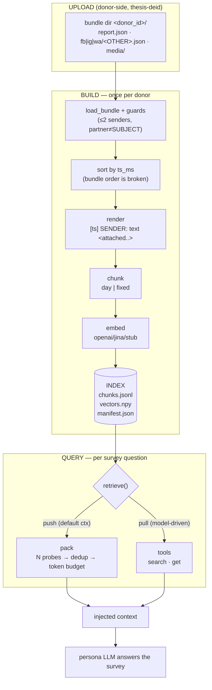

# Retrieval — spec

RAG over one donor's de-identified chat bundle, for persona survey simulation.
Corpus ≫ context → chunk + embed + retrieve. **One index == one donor** (`SUBJECT`).

Status: build → chunk → index → retrieve (vector + lexical) → smoke → loop all live, config-driven.
Decisions and measurements live in `PLAN.md`; upload-side findings in `FINDINGS-uploader.md`; this
file is the contract.

## 0. Pipeline



Push and pull are **the same `retrieve()`**; they differ only in who supplies the query and
whether the result is injected up-front (push) or inspected in a loop (pull).

## 1. Stages

| stage | in | out | notes |
|---|---|---|---|
| upload | raw exports | `bundle/` | donor-side; `report.json` + per-partner JSON + `media/` |
| load | bundle | `Thread[]` | rejects group leaks, `partner=="SUBJECT"`, unreadable |
| sort | threads | threads | `ts_ms` ascending — bundle order is desc/asc/mixed (463/67/112 of 642) |
| render | `Msg` | prompt line | `[YYYY-MM-DD HH:MM:SS] SENDER: text <attached: …> <react: …> <call: …> <link: …>` |
| chunk | thread | `Chunk[]` | `day` (default) or `fixed`; header line prefixed for self-containment |
| embed | `Chunk[]` | `vectors.npy` | index-time embedding = `Document:` side |
| index | chunks+vectors | dir | `chunks.jsonl` · `vectors.npy` · `manifest.json` |
| retrieve | query+filters | ranked regions | candidates → [rerank] → **pair** overlapping neighbours → top-k |
| pack (push) | probes | budgeted chunks | dedup by chunk id; budget soft |
| search/get (pull) | model args | tool JSON | same retrieve; `get` also expands ± messages |

Index artifacts: `chunks.jsonl` (one `Chunk` per line — id, platform, partner, seq, i0/i1, ts0/ts1,
`n_msgs`, `n_tokens`, day, header, text) · `vectors.npy` (numpy binary, float32, L2-normalised,
shape `[n_chunks × dim]` — `.npy` is just numpy's array format, so loading is zero-parse and the whole
matrix is one `@` with the query vector) · `manifest.json`.

**Module map** (9 files, ~1.4k LOC — one job each). Config loading is ~30 lines inside
`cli.py`: there is no config module.

| file | job |
|---|---|
| `bundle.py` | bundle → `Thread`/`Msg`; guards; `render_msg`; `thread_for`; logical day |
| `chunk.py` | `ChunkCfg`/`Chunk`, `chunk_id` (+`RENDER_VERSION`), `fixed` + `day` chunkers |
| `index.py` | `Index` load/save; the lexical blob (`lexical.bin` + `offsets.npy`) |
| `search.py` | filters + overlap rule (shared) · `search_vector` · `search_lexical` · `search_any` dispatch |
| `models.py` | HTTP clients: embeddings + reranking; prompt styles |
| `ops.py` | push `pack` · pull `get` · payloads · refs + tool schemas |
| `cli.py` | argparse + output rendering only |
| `smoke.py` | the test (query → expected pairs) |
| `__main__.py` | `python -m retrieval` |

## 2. Identity & provenance

One index == one donor. `manifest.json` records:

```json
{ "donor_id": "alice-01",            // asserted at query time (--expect-donor / $RETRIEVAL_DONOR)
  "donor": "SUBJECT",                // from report.json
  "bundle": "/…/bundle/dir", "bundle_generated_at": "…",
  "chunker": "day", "embedder": "openai", "embedder_cfg": {…},
  "threads": 624, "rejected": 18, "cfg": {…}, "n_chunks": 5469, "dim": 1024 }
```

- Query commands read the embedder + dim **from the manifest** — a call-time model would
  silently mismatch the vectors, so those flags don't exist at query time.
- `donor_id` resolution at build: `--donor-id` → `report.json.donor_id|subject_id` → bundle dir
  name (unless it's the generic `donation-YYYY-MM-DD`) → unset + warning.
- Every tool payload carries `donor`, so the loop can assert it's imitating the right person.

## 3. Config (`retrieval/config.yaml`)

Fixed settings, not flags. Build reads it; **query ignores it** (manifest wins).

```yaml
chunker: {name: day, target: 512, min: 256, max: 1024, overlap: 0.40,
          tz: Europe/Copenhagen, day_start_hour: 5, both_people: true}
embed:   {backend: openai, model: Qwen3-Embedding-0.6B,
          base_url: http://127.0.0.1:8091/v1, dim: 256, batch: 32, prompt: qwen3}
rerank:  {enabled: false, model: Qwen3-Reranker-0.6B, base_url: http://127.0.0.1:8092,
          path: /reranking}
retrieve: {k: 8, pack_budget: 40000, max_chars: 1200, min_threads: 2}
index:   {donor_id: alice-01, out: out/alice-01, bundle: ~/Downloads/alice-01}
```

**Two levels only:** a CLI flag overrides `config.yaml`. There are no profiles and no hidden
defaults — the file must supply every key the code reads (it is validated on load, and a missing key
is named in the error). Switching environment means pointing at a different complete file:
`--config config.server.yaml`. `config.yaml` is the local dev set (vllm-metal + Qwen3).

`chunker.name` defaults to `day`; `fixed` stays selectable as (a) the splitter `day` delegates to
for oversized days and (b) an eval baseline. `batch` is a low-priority knob: over HTTP the server
batches (vLLM continuous batching), so the client value only fans out requests; it matters for the
local PyTorch path only.

`--profile local|server` overlays `config.<profile>.yaml`:

| | local (dev, vllm-metal) | server (prod, vLLM/CUDA) |
|---|---|---|
| `embed.model` | `Qwen3-Embedding-0.6B` | `jina-embeddings-v5-text-small` |
| `embed.dim` | 256 (MRL-truncated: fast, small) | 1024 (max quality) |
| `embed.prompt` | `qwen3` (`Instruct: …\nQuery: …`) | `jina` (`Query: ` / `Document: `) |
| `rerank.model` | `Qwen3-Reranker-0.6B` | `jina-reranker-v3.5` |
| dtype | `float16` (fastest that fits) | server-side (`bf16`/`fp8`) |

**MRL** = Matryoshka Representation Learning: the model is trained so the *leading* `n` dims are
a valid embedding. Truncate + renormalise → smaller/faster, slight quality loss. Both
`jina-v5-small` and `Qwen3-Embedding-0.6B` are certified for truncation (1024 native, usable down
to 32). Rerankers have no dim (score only).

Note: truncation does **not** reduce build compute — the model runs the full 1024-dim forward pass
and slices afterwards. Measured corpus: 5469 × 1024 float32 = 22 MB, one full similarity scan is
sub-ms. **Decision: no `dim` knob — native (1024) everywhere.** It buys nothing here and only adds a
mismatch risk. Revisit if the corpus grows ~100× or an ANN index (below) enters.

**dim/config vs manifest.** yaml declares the intent for **both** build and query. The manifest
records the fact at build. Query reads config, then **asserts config == manifest** and aborts on
mismatch (`dim: 256 in config, but the index was built at 1024 — rebuild or fix config`). That's
how "must match" is enforced: seeded from the manifest, verified against config — never silently
divergent.

**Prompt styles** (`prompt:`), per model family — engine-agnostic (transformers / llama.cpp / vLLM
all just embed the text you send):

| model | query prefix | document prefix | `prompt:` |
|---|---|---|---|
| `jina-embeddings-v5-text-small` | `Query: ` | `Document: ` | `jina` |
| `Qwen3-Embedding-0.6B` | `Instruct: {task}\nQuery: {q}` | plain | `qwen3` |
| `bge-m3` | — | — | `none` |
| `Qwen3-Reranker-0.6B` | `<Instruct>: … <Query>: … <Document>: …` | — | `qwen3` |
| `jina-reranker-v3.5` | server-side | — | `none` |

Today this is a boolean (`--task-prompt`), which can only express the Jina case. Replace with the
style enum above (TODO 7b).

**Where the prefix is applied: client-side**, in our embedder/reranker client. The servers
(vLLM `/v1/embeddings`, `/v1/rerank`, llama.cpp `--reranking`) score whatever text they are handed —
they don't know the model's instruction convention, so a `Qwen3-Reranker` needs the
`<Instruct>…<Query>…<Document>…` string assembled before the HTTP call. `llama-swap` is a
model-lifecycle proxy (spawn/unload llama.cpp servers on demand); it does not template prompts, so
it's the wrong layer for this.
`dim` must be identical for the index and its queries → hence fixed in config, locked in the manifest.

**Overlap: pair, never drop, never repeat.** Consecutive overlapping chunks of one thread become one
item, with the repeated messages counted once (exact, by message index — never by text matching). Two
neighbours both ranking is evidence the region is relevant, and a message shown twice would read as
emphasis the donor never gave. Grouping is by **chunk count, not size**: 2 chunks → 1 item, 3 → 2 (a
pair + the single), 4 → 2 pairs (`retrieve.max_region_chunks: 2`), so items stay comparable when
scored. Merging frees slots, so the fill continues down the ranked list until `k` items exist. Items
expose `ids`, `i0..i1`, `n_msgs`, an **estimated** `n_tokens`, and a per-message index
(`msgs: [{key:"OTHER-001:793", ts, sender}]`) limited to messages actually *visible* after truncation
and folding — so a citation always refers to something the model read.

**Merge happens *after* reranking**: the cross-encoder judges uniform, unmerged chunks (its native
unit) and can judge each neighbour itself; merging then collapses near-duplicates and frees slots.
Pipeline: `candidates(pool) → rerank → merge_top(k)`.

**`ANN` (not needed yet).** ANN = a *search algorithm*, not a metric: cosine/dot/L2 is the metric;
ANN is how you avoid comparing against every vector. Options, roughly in order of effort:

| method | idea | when |
|---|---|---|
| exact brute force (**what we do**) | full matmul, `n_chunks × dim` | ≤ ~10⁶ vectors — sub-ms at our 5.5 k |
| IVF (FAISS `IndexIVFFlat`) | cluster vectors, probe the nearest `nprobe` cells | 10⁶–10⁷, cheap to build |
| PQ / IVFPQ | compress vectors (product quantisation) → less RAM, lossy | 10⁷+, memory-bound |
| HNSW (hnswlib, FAISS `IndexHNSWFlat`) | navigable small-world graph, log-ish lookup | 10⁶–10⁸, low latency, more RAM |
| LSH / ScaNN / DiskANN | random projections / learned / on-disk | special cases (streaming, huge, SSD) |

All are approximate unless paired with an exact re-rank. At ~5 500 chunks, exact is faster than
maintaining any such index.

---

## 4. Tool contract (agent-facing)

**Two modes, one retrieval.** `push` = inject context up-front (knows the survey probes ahead of
time). `pull` = the model queries in a loop (`search` to find, `get` to fetch/expand). Today these
are three CLI verbs (`pack` / `search` / `get`); TODO 7b renames them to the mode vocabulary:
`push` and `pull {'search'|'get'}` — same code path, no functional change.

| mode | op | args | returns |
|---|---|---|---|
| push | `push` | `probes[], k=4, budget=40000, min_threads=2` | deduped, budget-capped context (offline) |
| pull | `search` | `query, k=8, platform?, partner?, since?, until?` | ranked hits |
| pull | `get` | `id, window=0` | the chunk (`0`) or ±window raw messages (`>0`) |

`get` exists because a *result* and a *lookup* are different operations: `search` answers "what is
relevant to this query" (needs the query embedding, scans all vectors); `get` answers "give me #id,
plus the dialogue around it" (exact, no embedding, needs the bundle for `window>0`). After a hit
the model usually wants the second, not another search.

It is **not** redundant with `search`: (a) hits are truncated to `max_chars` — `get` returns the
full text; (b) `search` collapses overlapping spans from the same thread (`merge_overlap`), so the
neighbouring chunks are deliberately *not* returned — `get --window` is the only clean way to see the
surrounding dialogue; (c) after the loop trims old tool results, the model can still re-fetch a
known chunk. **Ids** are opaque 8-byte hex (`1d6b132d7ec39260`) =
`blake2b(RENDER_VERSION|platform|partner|i0|i1)`; they carry no information, are stable across
re-embeds, and are **never shown to the model** (see refs).

### Refs + constrained decoding (implemented, `refs.py`)
A model must not be asked to reproduce an opaque id. The loop hands it integers instead and closes
the set with a JSON-schema `enum`, so grammar/constrained decoding makes an unseen value
unemittable — impossible, not merely unlikely:

```python
reg = RefRegistry()
hits = reg.add(search_any(index, root, query, embedder, k=8))   # refs 1..8, monotonic for the run
tools = [search_tool_schema(), reg.get_tool_schema()]           # rebuild the enum after each search
chunk = reg.resolve(call.args["ref"])                           # the model can only pick a seen ref
```

`get.parameters.ref` becomes `{"type":"integer","enum":[1,2,3,…]}`. Rationale for **integers**:
shortest tokens, trivially small logit mask, tokenizer-agnostic. An enum of 16-hex-char ids expands
into ~16 constrained positions per candidate and is far more fragile. Refs are monotonic for the
run, so a hit from turn 3 is still fetchable at turn 40, and a chunk seen twice keeps its ref.
(Per-response `rank` in every payload is the same integer for same-turn use.)

```bash
export RETRIEVAL_INDEX=retrieval/out/alice-01 RETRIEVAL_DONOR=alice-01   # index == donor
uv run python -B -m retrieval build --bundle ~/Downloads/donation-2026-09-19 --out out/alice-01 --kind lexical
uv run python -B -m retrieval push   --probe "hvad synes du om arbejde?" --probe "familie"
uv run python -B -m retrieval pull search "hvad synes du om arbejde?" -k 8 --partner OTHER-052
uv run python -B -m retrieval pull get  <id> --window 10
uv run python -B -m retrieval smoke
```

JSON is the contract (default); `--pretty` renders for humans. Fixed settings live in
`config.yaml` + `config.<profile>.yaml` (`--profile local|server`), never in flags; `-k`/`--budget`/
`--min-threads` are overrides of the config defaults. The embedder is read from the index manifest
(the fact) and a disagreeing config only warns — the vectors were built with the manifest, so it
always wins.

**Three size axes, not one knob** — they act at different levels:

```
budget          the WHOLE push result: sum(n_tokens) over every kept chunk,
                stop at 40 000 tok.  (how MANY chunks)
   │
   ├─ max_chars   each returned hit: text[:1200] chars.            (how MUCH of each chunk)
   │
   └─ window      one hit, expanded: ±N raw messages around it.     (how MUCH around a hit)
```

Concrete, same chunk (`OTHER-632 seq0`, 11 msgs, 201 tok, day 2025-01-17):

| call | what comes back | size |
|---|---|---|
| `push --probe "…" --budget 40000` | up to N chunks, sum ≤ 40 000 tok | ~2 400 tok for the example set |
| `search "…" -k 8 --max-chars 1200` | 8 hits, each capped at 1200 chars | ~2 400 tok |
| `search "…" -k 8 --max-chars 0` | the same 8 hits, full text | as big as the chunks |
| `get <id>` | this one chunk, complete | 201 tok |
| `get <id> --window 5` | msgs `i0-5 … i1+5` (raw lines, may cross into neighbours) | 201 tok + neighbours |

Overlap: `budget` bounds the pack; `max_chars` bounds each element *inside* it; `window` bypasses
both because it is an explicit model request for more detail (the model has chosen to spend the
context). TODO 7b drops `max_chars` from the tool surface (constant), keeping `budget` + `window`.

### Output — JSON (the machine contract)

```json
{"donor":"alice-01","query":"koden til døren","k":1,
 "hits":[{"id":"1d6b132d7ec39260","platform":"fb","partner":"OTHER-632","day":"2025-01-17",
          "seq":0,"ts0":1737122840351,"ts1":1737198400849,"n_msgs":11,"n_tokens":201,
          "text":"# fb OTHER-632 · 2025-01-17 · SUBJECT+OTHER-632\n[2025-01-17 14:07:20] SUBJECT: …",
          "truncated":true,"score":0.1768,"rank":1}]}
```

### Output — human (default today)

```
donor=alice-01
#1 +0.177  fb/OTHER-632 seq0 msgs[0:11] 201tok 2025-01-17  id=1d6b132d7ec39260
  # fb OTHER-632 · 2025-01-17 · SUBJECT+OTHER-632
  [2025-01-17 14:07:20] SUBJECT: Jeg vil gerne købe dem og hente den i dag?
```

`--json` opts into the first; **proposed**: make JSON the default (it's the tool contract) and
keep the pretty form behind `--pretty`.

## 5. Render rules & the media masks

`[ts] SENDER: text` + optional `<attached: …> <react: …> <call: …> <link: …>`; bursts collapse
to `xN`. Never-parsed media collapse to a **kind mask**: `PHOTO`, `VIDEO`, `FILE`. Audio is the one
exception — it keeps its raw filename today.

**Now** (real output, `wa/OTHER-847`, chunk of `2023-02-20`):

```
[2023-02-20 13:33:33] OTHER-847:  <attached: 00000008-AUDIO-2023-02-20-13-33-33.opus>
bundle file:  media/00000008-AUDIO-2023-02-20-13-33-33.opus   (60.9 KB)
raw message:  {"ts_ms":1676900013000, "sender":"OTHER-847", "text":"",
               "media":[{"name":"00000008-AUDIO-2023-02-20-13-33-33.opus", "kind":"audio"}]}
```

`ts_ms=1676900013000` ≡ `2023-02-20 13:33:33Z` — **the filename's timestamp is the message's
`ts_ms`**, already printed at the start of that same line. So the name is duplicated data plus a
leaked capture time (and ~45 chars of prompt, every time).

**Proposed**:

```
[2023-02-20 13:33:33] OTHER-847:  <attached: AUDIO#1>
```

**Implemented** (`RENDER_VERSION = v2`). `#k` = index within that message's `media` array
(1-based); same mask treatment as photo/video. Consequences measured on the full corpus: the
filename (~45 chars) was duplicated data, so chunk boundaries shift slightly — **5469 → 5454
chunks** — because the token counter is char-based. And `max` is now a hard ceiling: the overlap
prefix may only use the headroom left (`max − window`), and a backward message that doesn't fit is
skipped; only a **single message longer than `max`** (4 chunks in the corpus) still exceeds it,
because a message is atomic. Traceability is preserved without putting the name in the prompt:

```
prompt mask  AUDIO#2
  → chunk.id            (chunks.jsonl: id, platform, partner, i0, i1)
  → thread msg i0+n     (bundle/<platform>/<partner>.json, messages sorted by ts_ms)
  → msg.media[2-1].name ("00004564-AUDIO-….opus")
  → bundle/media/<name>
```
So the future STT step can drop the transcript into that exact slot: same chunk, same message,
same media index. Photos/videos stay masks forever (no vision in scope). If a human wants the
filename, it's one `jq` away in the bundle — the prompt never needs it.

## 5b. The loop (`loop.py`, CLI `loop`)

| responsibility | detail |
|---|---|
| prompt | persona system message (the donor) + the survey question; `--push` prepends one `pack` |
| tools | `search`, plus `get` whose `ref` enum is **rebuilt every turn** from the refs handed out |
| state | `RefRegistry` (ref → item), message-level seen-set, injected-token budget, turn/tool caps |
| dedupe | the seen-set is shared across turns; a message is never shown twice — "seen" means *shown*, so truncation cannot strand unread messages |
| stop | model stopped calling tools · `max_turns` · `max_calls` · budget |

`--dry-run` prints the exact request (system, question, tools) and calls nothing, so the wiring is
testable without a model. Model/index specifics come from config (`llm:`, `embed:`).

## 6. Testing: `smoke` (implemented); `eval` deleted

**`smoke`** (`retrieval/smoke.py`) runs hand-written `query → expected` pairs over a **real** index
and exits non-zero on any failure — the regression net for refactors. Each case may constrain
`partner`, `day`, and/or a `contains` substring; all must hold for the *same* hit within top-k.
Default cases are real pairs from the demo bundle; override with `--cases X.json`.

```
$ uv run python -B -m retrieval smoke -k 5
  ok  #1   'koden til døren'
  ok  #1   '1505#'
  ok  #3   'real madrid'
summary  donor=alice-01  kind=lexical  rerank=False  6/6 passed, 5 at rank 1   (0.7 s, offline)
```

It runs through whatever retriever the index declares (lexical: no model, no server; vector: needs
the embedder) and can rerank the candidate pool. The synthetic `eval` (self-retrieval + the fake
`stub` embedder) is **deleted** — it measured nothing; `eval` now exits with a pointer to `smoke`.

## 7. TODO

### 7a. Upload-side → `FINDINGS-uploader.md`
Donor id in the bundle (U1), `sources` PII leak (U2), move the data-quality gates (U3), media
filename timestamps (U4), subject timezone (U5), partner-identity hints (U6). Retrieval currently
works around all of these and should be able to drop the workarounds once the bundle carries the
metadata. **No upload TODO lives in this file.**

### 7b. Retrieval implementation plan — S1/S2/S3/S5/S6 **done** 2026-10-13

**[done] S1 — `config.yaml` + profiles.** `retrieval/config.py` loads `config.yaml`, overlays
`config.<profile>.yaml` (`--profile local|server`). Precedence: CLI flag > profile > base > default.
Moves ~20 flags out of the CLI (`chunker.*`, `embed.*`, `rerank.*`, `retrieve.k`, `index.*`); the
only per-call args left are the query, `k`/filters, and `--window`. Dep: `pyyaml`.

**[done] S2 — one surface, mode vocabulary.** `pack`→`push`; `search`/`get`→`pull search` / `pull get`.
JSON becomes the default output; `--pretty` for humans; `--json` disappears. `--max-chars` leaves
the tool surface (constant). `min_threads` (yaml default 2) is enforced by `push` and overridable
per call by the model on `pull`.

**[done] S3 — lexical retriever, replacing `stub`.** `index.kind: vector|lexical`. Lexical builds chunks
with **no** `vectors.npy`; `search` dispatches on `index.kind` and scores by regex match density
over chunk text, then reuses the same filters + overlap-merge. No model, no server → instant,
offline, and genuinely useful (exact names, numbers, dates, quoted phrases). `stub` is deleted.

*Layout* (answering "one big txt?"): yes — `lexical.bin` (all chunk texts concatenated,
`\n\x00\n`-separated) + `offsets.npy` (int64 start per chunk) + the same `chunks.jsonl` for
metadata. One sequential `mmap` + `re.finditer` scan over the full corpus (~30 MB of text, ≈7.2 M
tokens) is single-digit ms, and avoids JSON unescaping / per-line parsing. Chunk boundaries are
natural match limits — an exact phrase can only match inside one chunk, which is the retrieval unit
by design, not a limitation.

*Fuzzy is deliberately deferred to V2*, where it can share a design with recency-weighted scoring:
it needs a scoring model (BM25 or `rapidfuzz`), an index representation, and a rule for blending
lexical + cosine + time-decay — all out of scope now.

**S4 — replace eval with `smoke`.** Delete `eval/`; add `retrieval/smoke.py`: ~10 hand-written
query → expected pairs against a tiny real index, regex + optional reranker, pass/fail. Wire it as
`retrieval smoke`.

**[done] S5 — prompt-style enum.** `prompt: jina|qwen3|none` replaces `--task-prompt` (see §3 table),
applied to embed and rerank calls.

**[done] S6 — audio mask.** `<attached: AUDIO#k>` + `RENDER_VERSION` bump (invalidates chunk ids →
re-embed). `RENDER_VERSION` bumped to `v2` (mask + id inputs); full corpus rebuilt (5454 chunks).

## 8. Open decisions / out of scope
- **Out of scope (deliberate): the loop never runs past its context window** → no context compaction,
  no "re-fetch a chunk whose search result was evicted". That removes the last argument for ids in
  the tool surface: the model only ever chooses among refs it can still see. (The capability has value
  outside this experiment; noted so it doesn't look like an oversight.)
- Audio mask `<attached: AUDIO#k>`: see §5 — approved, lands in S6.
- ID inputs: `ts0`/`ts1` dropped — the span is `i0/i1`; a re-sorted bundle is a rebuild, and the
  manifest already records `bundle` + `bundle_generated_at`.
- `tz`: keep fixed in yaml (chunk-boundary heuristic only); upload records the subject's tz later (U5).
- Fuzzy search: V2, paired with recency-weighted scoring.
- Keep `min_score` out of the tool? (raw cosine is uncalibrated; ranks carry the signal)
- Recency weighting (backlog): time-decay over `Chunk.ts1` × cosine.
